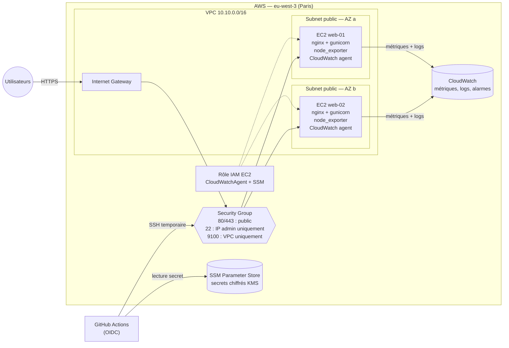
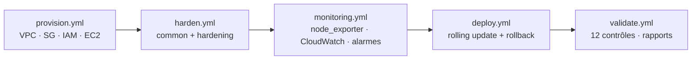
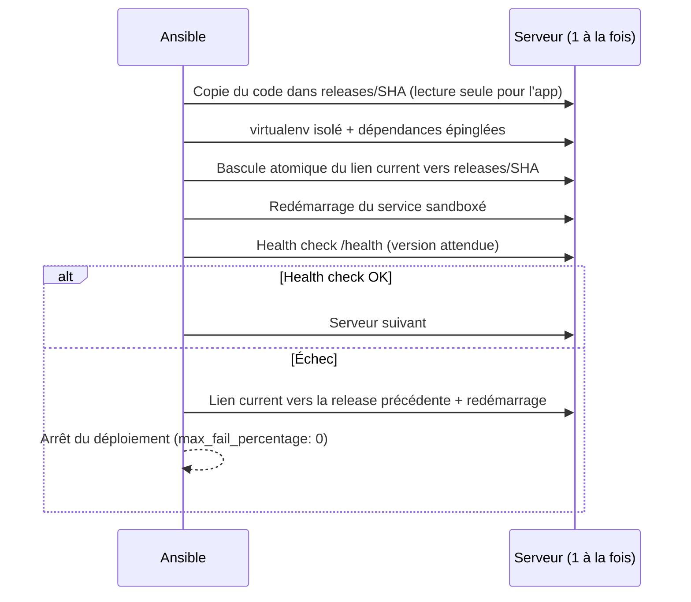

# Automatisation Cloud AWS avec Ansible


Playbooks Ansible qui **provisionnent** une infrastructure AWS, **durcissent** des serveurs Linux
(référentiel inspiré du CIS Benchmark), **installent des agents de supervision** et **déploient une
application de façon sécurisée**, le tout piloté par un **pipeline CI/CD** GitHub Actions avec
tests automatisés, validation de conformité et détection de dérive de configuration.

> Un seul `make site` crée le VPC et les instances, applique plus de 50 mesures de sécurité, installe
> Prometheus node_exporter et l'agent CloudWatch, déploie l'application en rolling update avec
> rollback automatique, puis produit un rapport de conformité.

---

## Sommaire

- [Points clés](#points-clés)
- [Architecture](#architecture)
- [Structure du dépôt](#structure-du-dépôt)
- [Rôles Ansible](#rôles-ansible)
- [Mesures de sécurité](#mesures-de-sécurité)
- [Démarrage rapide](#démarrage-rapide)
- [Pipeline CI/CD](#pipeline-cicd)
- [Tests et qualité](#tests-et-qualité)
- [Rapport de conformité](#rapport-de-conformité)
- [Choix techniques](#choix-techniques)
- [Pistes d'amélioration](#pistes-damélioration)

---

## Points clés

| Domaine | Ce que fait le projet |
|---|---|
| **Infrastructure as Code** | VPC multi-AZ, subnets, Internet Gateway, Security Group, rôle IAM, EC2 — 100 % Ansible (`amazon.aws`), idempotent |
| **Inventaire dynamique** | Instances découvertes par tags (`amazon.aws.aws_ec2`) : aucune IP en dur dans le dépôt |
| **Hardening** | SSH par clé uniquement, crypto moderne, sysctl, pare-feu nftables, auditd, fail2ban, mises à jour de sécurité automatiques |
| **Supervision** | Prometheus node_exporter (checksum SHA-256 vérifié, service sandboxé) + agent CloudWatch (signature GPG vérifiée) + alarmes CloudWatch avec auto-recovery EC2 |
| **Déploiement sécurisé** | Releases immuables, rolling update `serial: 1`, health check, **rollback automatique**, service systemd sandboxé, TLS + en-têtes de sécurité |
| **Secrets** | AWS SSM Parameter Store (KMS) ou Ansible Vault — jamais en clair dans le dépôt, `no_log` sur les tâches sensibles |
| **CI/CD** | Lint → tests Molecule → déploiement via **OIDC** (zéro clé AWS stockée) → rapport de conformité publié dans le job |
| **Validation** | 12 contrôles de conformité exécutés après chaque déploiement, rapport JSON + Markdown, détection de dérive quotidienne |
| **Multi-OS** | Ubuntu 22.04 / 24.04 et famille RHEL 9 (Rocky Linux 9 testé en CI, Amazon Linux 2023) |

---

## Architecture

### Infrastructure AWS



### Pipeline d'automatisation



### Flux de déploiement d'une release



---

## Structure du dépôt

```text
.
├── ansible.cfg                  # Config Ansible (pipelining, cache, callbacks)
├── Makefile                     # Point d'entrée : make site ENV=dev
├── requirements.yml / .txt      # Collections Ansible / dépendances Python
├── inventories/
│   ├── dev/                     # Inventaire dynamique EC2 + variables d'environnement
│   └── prod/
├── playbooks/
│   ├── site.yml                 # Pipeline complet
│   ├── provision.yml            # Infrastructure AWS
│   ├── harden.yml               # Configuration de base + durcissement
│   ├── monitoring.yml           # Agents + alarmes CloudWatch
│   ├── deploy.yml               # Déploiement rolling
│   ├── validate.yml             # Contrôles de conformité + rapports
│   └── teardown.yml             # Destruction (avec confirmation)
├── roles/
│   ├── aws_infra/               # VPC, subnets, SG, IAM, EC2
│   ├── common/                  # Paquets, NTP AWS, comptes admin
│   ├── hardening/               # SSH, kernel, nftables, auditd, fail2ban, MAJ auto
│   ├── monitoring/              # node_exporter + agent CloudWatch
│   ├── app_deploy/              # nginx TLS + app Python sandboxée
│   └── validation/              # Matrice de conformité + rapports
├── molecule/default/            # Tests d'intégration (Ubuntu 24.04 + Rocky 9)
├── .github/
│   ├── workflows/               # ci.yml · deploy.yml · drift-detection.yml
│   └── actions/                 # Actions composites réutilisables
├── scripts/ci-ssh-access.sh     # Ouverture/fermeture SSH temporaire pour le runner
└── docs/iam/                    # Politiques IAM (OIDC + moindre privilège)
```

---

## Rôles Ansible

| Rôle | Responsabilité | Éléments notables |
|---|---|---|
| [`aws_infra`](roles/aws_infra) | Provisionnement AWS | Refuse `0.0.0.0/0` sur SSH · IMDSv2 obligatoire · EBS chiffré · AMI officielle la plus récente · répartition multi-AZ · filtres d'idempotence explicites |
| [`common`](roles/common) | Socle système | Attente de cloud-init (évite les verrous apt) · Amazon Time Sync Service · comptes admin par clé uniquement · `visudo -cf` avant écriture |
| [`hardening`](roles/hardening) | Durcissement CIS | Config sshd validée par `sshd -t` avant remplacement · nftables validé par `nft -c` · règles auditd · fail2ban · mises à jour de sécurité auto |
| [`monitoring`](roles/monitoring) | Observabilité | Archive node_exporter vérifiée par SHA-256 · paquet CloudWatch vérifié par GPG (empreinte épinglée) · unités systemd sandboxées |
| [`app_deploy`](roles/app_deploy) | Déploiement | Releases immuables · rollback automatique · nginx durci (TLS 1.2/1.3, HSTS, CSP, rate limiting) · secret en `no_log` |
| [`validation`](roles/validation) | Conformité | 12 contrôles indépendants de l'implémentation · rapport par hôte (JSON) et consolidé (Markdown) |

---

## Mesures de sécurité

| Couche | Mesure | Vérifiée par |
|---|---|---|
| **Réseau AWS** | Security Group : 80/443 publics, SSH limité aux IP admin, 9100 limité au VPC, sortie limitée à 80/443 ; Security Group par défaut du VPC vidé (CIS AWS 5.4) | `aws_infra` (assert) |
| **Instance** | IMDSv2 obligatoire (anti-SSRF), EBS chiffré, rôle IAM minimal | `aws_infra` |
| **SSH** | Clé publique uniquement, root interdit, `AllowGroups`, crypto moderne (curve25519, chacha20, AES-GCM, MAC ETM), pas de forwarding, `MaxAuthTries 3`, bannière | `SSH-01`, `SSH-02` |
| **Noyau** | Pas de routage ni redirections ICMP, anti-spoofing (`rp_filter`), SYN cookies, ASLR, `kptr_restrict`, `dmesg_restrict`, pas de core dumps SUID | `KRN-01` |
| **Modules** | cramfs, hfs, udf, usb-storage, dccp, sctp, rds, tipc désactivés | — |
| **Pare-feu hôte** | nftables, politique `drop` en entrée et en forward, seule la table du projet est gérée | `NET-01`, `NET-02` |
| **Audit** | auditd : identités, sudoers, sshd_config, heure système, chargement de modules, changements de permissions | `AUD-01` |
| **Brute force** | fail2ban (journal systemd → bannissement nftables) | `SVC-01` |
| **Mises à jour** | unattended-upgrades / dnf-automatic (sécurité uniquement) | `UPD-01` |
| **Comptes** | Expiration des mots de passe, `UMASK 027`, sudo journalisé + `use_pty` | — |
| **Chaîne d'approvisionnement** | Checksum SHA-256 (node_exporter), signature GPG à empreinte épinglée (CloudWatch), dépendances Python épinglées | `monitoring` (assert) |
| **Application** | Utilisateur dédié sans shell, code en lecture seule, systemd sandboxé (`ProtectSystem=strict`, `NoNewPrivileges`, pas de capabilities) | `SVC-01`, `APP-01` |
| **Web** | HTTP → HTTPS, TLS 1.2/1.3, HSTS, CSP, X-Frame-Options, nosniff, `server_tokens off`, rate limiting | `APP-02`, `APP-03` |
| **CI/CD** | OIDC (aucune clé AWS longue durée), SSH ouvert uniquement pour l'IP du runner et refermé en `always()`, approbation manuelle en prod | workflows |
| **Pipeline** | Actions épinglées par SHA de commit + Dependabot, jeton GitHub en lecture seule par défaut (permissions par job), aucun secret interpolé dans les scripts shell, clé SSH effacée du runner en fin de job | workflows, [SECURITY.md](SECURITY.md) |

---

## Démarrage rapide

### Prérequis

- Python 3.10+ sur le poste de contrôle (Linux, macOS ou WSL)
- Un compte AWS et des identifiants configurés (`aws configure` ou SSO)
- Docker (uniquement pour les tests Molecule)

### 1. Installation

```bash
git clone https://github.com/Ngouye/ProjectAnsible.git
cd ProjectAnsible
python -m venv .venv && source .venv/bin/activate
make install
```

### 2. Configuration

```bash
# Paire de clés SSH dédiée au projet
ssh-keygen -t ed25519 -f ~/.ssh/ansible-aws-automation -C ansible-aws-automation

# Votre IP publique, autorisée en SSH dans le Security Group
curl -s https://checkip.amazonaws.com
# -> remplacer 203.0.113.10/32 dans inventories/dev/group_vars/all/main.yml (aws_infra_admin_cidrs)

# Secret applicatif, chiffré par KMS dans SSM Parameter Store
aws ssm put-parameter --region eu-west-3 --type SecureString \
  --name /ansible-aws-automation/dev/app_secret_key \
  --value "$(openssl rand -hex 32)"
```

> Alternative sans SSM : copier `vault.yml.example` en `vault.yml` puis `ansible-vault encrypt`.

### 3. Exécution

```bash
make site                 # pipeline complet sur dev
make site ENV=prod        # sur prod
make harden               # une seule étape
make drift                # dry-run : affiche les écarts sans rien modifier
make validate             # contrôles de conformité -> reports/
make teardown             # destruction de l'environnement
```

Résultat : l'application répond sur `https://<ip-publique>/` (certificat auto-signé pour la démo).

```json
{"environment": "dev", "host": "ip-10-10-1-23", "service": "ansible-aws-automation", "version": "1.0.0"}
```

---

## Pipeline CI/CD

| Workflow | Déclencheur | Étapes |
|---|---|---|
| [`ci.yml`](.github/workflows/ci.yml) | Pull request, push | `yamllint --strict` · `ansible-lint` (profil production) · syntax-check · gitleaks · **Molecule** (converge, idempotence, conformité) |
| [`deploy.yml`](.github/workflows/deploy.yml) | Push sur `main` (dev) · manuel (dev/prod) | Quality gate (ci.yml) → OIDC AWS → ouverture SSH pour l'IP du runner → playbook → fermeture SSH (`always()`) → rapport dans le résumé du job |
| [`drift-detection.yml`](.github/workflows/drift-detection.yml) | Chaque nuit · manuel | `--check --diff` sur le hardening et le monitoring : échec si un serveur a été modifié à la main, puis contrôles de conformité |

### Mise en place (une fois)

1. **Fournisseur OIDC GitHub dans AWS** : IAM → Identity providers → `token.actions.githubusercontent.com`, audience `sts.amazonaws.com`.
2. **Rôle de déploiement** : politique de confiance [`docs/iam/github-oidc-trust-policy.json`](docs/iam/github-oidc-trust-policy.json) et permissions [`docs/iam/deploy-policy.json`](docs/iam/deploy-policy.json) (remplacer `<ACCOUNT_ID>` par l'ID de votre compte AWS).
3. **Environnements GitHub** `dev` et `prod` (Settings → Environments), avec *Required reviewers* sur `prod`.
4. **Secrets** de chaque environnement :

| Secret | Contenu |
|---|---|
| `AWS_DEPLOY_ROLE_ARN` | ARN du rôle créé à l'étape 2 |
| `SSH_PRIVATE_KEY` | Clé privée `~/.ssh/ansible-aws-automation` |

5. **Variable de dépôt** `DEPLOY_ENABLED=true` (Settings → Variables) pour activer le déploiement
   automatique sur push et la détection de dérive nocturne. Sans elle, seule la quality gate
   (lint + Molecule) s'exécute, et le déploiement reste disponible en lancement manuel.

---

## Tests et qualité

```bash
make lint      # yamllint --strict + ansible-lint --profile production
make syntax    # ansible-playbook --syntax-check sur chaque playbook
make test      # molecule test (Docker)
```

**Molecule** exécute toute la pile (`common` → `hardening` → `monitoring` → `app_deploy`) dans des
conteneurs systemd **Ubuntu 24.04** et **Rocky Linux 9**, puis :

1. vérifie l'**idempotence** (un second passage ne doit produire aucun changement) ;
2. lance le rôle **`validation`** comme vérificateur : ce qui est testé en CI est exactement ce qui
   est contrôlé en production après chaque déploiement.

Les contrôles qui dépendent du noyau (sysctl, nftables, auditd) sont automatiquement marqués
« N/A » dans un conteneur et pleinement appliqués sur EC2.

---

## Rapport de conformité

`validate.yml` écrit `reports/<hôte>.json` et un rapport consolidé `reports/compliance-report.md`,
également publié dans le résumé du job GitHub Actions :

| ID | Contrôle | Résultat |
|---|---|---|
| SSH-01 | Configuration sshd effective conforme (`sshd -T`) | PASS |
| SSH-02 | `sshd_config` lisible par root uniquement (0600) | PASS |
| KRN-01 | Paramètres noyau actifs (sysctl) | PASS |
| NET-01 | Pare-feu actif, politique d'entrée `drop` | PASS |
| NET-02 | Aucun port TCP inattendu exposé | PASS |
| AUD-01 | auditd actif avec les règles chargées | PASS |
| SVC-01 | Services requis démarrés | PASS |
| UPD-01 | Mises à jour de sécurité automatiques | PASS |
| MON-01 | node_exporter expose ses métriques | PASS |
| APP-01 | Application saine en HTTPS | PASS |
| APP-02 | HTTP redirigé vers HTTPS | PASS |
| APP-03 | En-têtes de sécurité présents | PASS |

Le playbook échoue si un contrôle applicable n'est pas conforme.

---

## Choix techniques

- **Valider avant d'appliquer** : `sshd -t`, `nft -c`, `visudo -cf` et `nginx -t` vérifient la
  nouvelle configuration *avant* qu'elle ne soit appliquée : une erreur de frappe ne peut pas
  couper l'accès au serveur.
- **Filtrage IP au niveau du Security Group** : la liste blanche SSH est gérée côté AWS, où le
  pipeline peut ouvrir puis refermer l'accès pour l'IP éphémère du runner. nftables assure la
  défense en profondeur (ports, politique `drop`) et fail2ban bloque le brute force.
- **nftables plutôt qu'ufw/firewalld** : un seul outil et un seul template pour Debian et RHEL, et
  seule la table `inet hardening` est remplacée (les règles de fail2ban sont préservées).
- **Releases immuables + lien symbolique** : le passage d'une version à l'autre est atomique et le
  rollback ne consiste qu'à repointer le lien, sans réinstallation.
- **Tests indépendants de l'implémentation** : le rôle `validation` déclare ses propres valeurs
  attendues et lit l'état *effectif* (`sshd -T`, `sysctl`, ports en écoute), pas les fichiers écrits.
- **Fichiers `sshd_config.d/` ignorés** : cloud-init ou une mise à jour de paquet ne peuvent pas
  réactiver silencieusement l'authentification par mot de passe.

---

## Pistes d'amélioration

- Application Load Balancer + certificat ACM, instances dans des subnets privés avec NAT Gateway
- Connexion via AWS SSM Session Manager (plus aucun port 22 ouvert)
- Auto Scaling Group avec AMI « golden » construite par Packer + ce même hardening
- Authentification TLS / basic auth sur node_exporter et serveur Prometheus + Grafana
- Rapport de conformité complet avec OpenSCAP / CIS-CAT

---

## Coûts

Avec la configuration `dev` (2 × `t3.micro`), le coût est de l'ordre de quelques centimes par heure
(instances, volumes EBS, logs CloudWatch). **Pensez à `make teardown` après une démonstration.**

## Licence

[MIT](LICENSE) — Ngouye Gning
